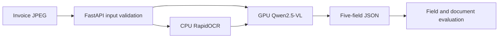
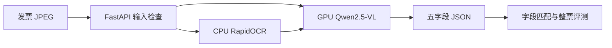

# Multimodal Tax Document Understanding with Qwen2.5-VL

[English](#english) · [中文](#中文)

---

<a name="english"></a>

## English

Convert Chinese VAT invoice images into structured JSON with **Qwen2.5-VL-7B-Instruct and RapidOCR**. The system extracts invoice number, date, buyer name, buyer tax ID, and tax-inclusive total, served through vLLM and FastAPI.

The project covers data preparation, LoRA comparisons, OCR-assisted visual understanding, structured evaluation, and API deployment. Fixed annotations, field-level evaluation, and service retesting inform the final **base model + OCR** configuration.

### System design



- **Multimodal extraction:** combines the original image with OCR text to produce a consistent five-field JSON object, covering ordinary invoices, fully digital invoices, and discount lines.
- **Parameter-efficient fine-tuning:** uses LLaMA-Factory for LoRA training and compares base/adapted models with and without OCR to select the serving configuration.
- **Traceable evaluation:** deduplicates by invoice number and fixes annotations before inference; measures field matches and complete-document matches while preserving null and leading-zero requirements.
- **API deployment:** CPU OCR, vLLM inference on an A10 GPU, and FastAPI image input, JSON output, and error responses.

### Results

| Metric | Measured result |
|---|---:|
| Held-out invoice evaluation | 15 invoices |
| Matches on annotated fields | 68/72 (94.4%) |
| All five fields correct on fully annotated invoices | 11/14 |
| Median end-to-end request latency | 5.59 s/invoice |
| Field consistency in sampled API retests | 5/5 |

Fourteen invoices have five annotated fields each; one has two verifiable fields, yielding 72 labeled fields. Results use the **base model + OCR** configuration. Latency includes OCR and was measured with serial loopback API requests on one NVIDIA A10. See the [experiment record](docs/experiment.md) for sample composition, training comparisons, and configuration selection, and [final_metrics.json](results/final_metrics.json) for aggregate metrics.

### View recorded results

Use Python 3.10 or newer from the repository root. This standard-library-only command prints three recorded, redacted cases—electricity, discount, and construction invoices—to demonstrate outputs and field checks.

```bash
python scripts/demo.py
```

examples/recorded_cases.json retains dates and amounts; invoice numbers, tax IDs, and buyer names are replaced with redacted. Original invoices, per-invoice personal information, weights, and local connection settings remain in the experiment environment. See the [data notes](docs/data.md) for data context.

### Start the live service

Experiments used Python 3.12/3.13. Match PyTorch, CUDA, and vLLM to your GPU environment. Offline cases, scoring rules, and the API contract have been checked; GPU measurement conditions are documented in the experiment record.

```bash
python -m venv .venv
source .venv/bin/activate
pip install -r requirements.txt
# Install vLLM in a compatible CUDA-enabled Linux GPU environment
pip install vllm
bash scripts/serve_model.sh
```

Set MODEL_PATH to a local Qwen2.5-VL-7B-Instruct weights directory if needed; otherwise the model identifier is used. The model server listens on 127.0.0.1:18641, with prefix caching disabled and a visual pixel limit of 501760.

In a second terminal using the same environment, start CPU OCR and the API gateway:

```bash
uvicorn app.api:app --host 127.0.0.1 --port 18642
python scripts/demo.py --image /path/to/invoice.jpg
```

API documentation: http://127.0.0.1:18642/docs. POST /extract/tax accepts image_b64 and optional use_ocr, enabled by default. Inputs must be JPEG images of no more than 20 million pixels. Invalid images return 422; upstream failures return 502. Services bind to loopback by default; use SSH forwarding for remote access.

### LoRA training and scoring

Install LLaMA-Factory following its official repository. Training uses rank 8, alpha 16, q_proj/v_proj targets, frozen vision and multimodal projection modules, a 0.0001 learning rate, and two epochs. The training comparison uses 29 Chinese VAT special invoices.

Create data/manifest.json with a train list whose entries contain id and a five-field target object. Place matching images in images/id.jpg, then run:

```bash
python scripts/prepare_training.py
llamafactory-cli train configs/lora.yaml
```

Use data you are authorized to use and freeze the split before evaluation. The gold JSON contains a docs list of id and target entries. The prediction directory contains id.json files, each with a fields object.

```bash
python scripts/score.py data/gold.json outputs/predictions
```

Dates are normalized by year, month, and day; amounts by numeric value. Invoice numbers and tax IDs retain leading zeros. Empty fields must be JSON null.

### Dependencies and documentation

- [Qwen2.5-VL](https://github.com/QwenLM/Qwen2.5-VL)
- [LLaMA-Factory](https://github.com/hiyouga/LLaMA-Factory)
- [RapidOCR](https://github.com/RapidAI/RapidOCR)
- [vLLM](https://github.com/vllm-project/vllm)

Supporting [experiment](docs/experiment.md) and [data](docs/data.md) documents are currently in Chinese. Obtain dependencies, models, and data under their respective terms of use.

[Back to language selection](#multimodal-tax-document-understanding-with-qwen25-vl)

---

<a name="中文"></a>

## 中文

中文增值税发票图像转 JSON。使用 Qwen2.5-VL-7B-Instruct 与 RapidOCR 提取票号、日期、购买方名称、购买方税号和价税合计，并通过 vLLM 和 FastAPI 提供接口。

项目覆盖数据准备、LoRA 微调对照、OCR 辅助视觉理解、结构化评分与 API 部署。通过固定标签、逐字段评测和服务复测选择推理配置，最终采用基座加 OCR。

### 系统设计



- **多模态抽取** 将原图与 OCR 转写共同交给模型，输出统一的五字段 JSON，覆盖普通发票、数电票和含折扣行的票面。
- **参数高效微调** 使用 LLaMA-Factory 完成 LoRA 训练，比较基座、适配器及 OCR 组合，依据验证结果选择部署方案。
- **可核验评测** 按票号去重并在推理前固定标签，分别统计字段匹配和整票匹配，保留空值及前导零的评分要求。
- **服务化交付** CPU 执行 OCR，A10 GPU 通过 vLLM 推理，FastAPI 提供图片输入、JSON 输出及异常响应。

### 验证结果

| 指标 | 实测结果 |
|---|---:|
| 独立发票评测 | 15 张 |
| 已标注字段匹配 | 68/72（94.4%） |
| 完整标注发票五字段全对 | 11/14 |
| 端到端请求耗时中位数 | 5.59 秒/张 |
| 抽样 API 复测逐字段一致 | 5/5 |

14 张发票各标注五字段，另 1 张标注两个可核对字段，共 72 项。成绩来自基座加 OCR 配置。耗时为单张 NVIDIA A10 上串行回环 API 请求的测量结果，包含 OCR。样本组成、训练对照和配置选择依据见 [实验记录](docs/experiment.md)，聚合指标见 [final_metrics.json](results/final_metrics.json)。

### 快速查看结果

使用 Python 3.10 及以上，在仓库根目录执行。此命令仅需标准库，打印三组已记录并脱敏的电力票、折扣票和工程票结果，用于展示输出及字段核对。

```bash
python scripts/demo.py
```

examples/recorded_cases.json 保留日期和金额，票号、税号和购买方名称替换为 redacted。原始票据、逐票个人信息、模型权重和本机连接配置保存在实验环境。获取数据和重新核验的流程见 [数据说明](docs/data.md)。

### 启动实时服务

实验环境使用 Python 3.12/3.13。以下依赖范围用于安装，具体 GPU 环境需匹配 PyTorch、CUDA 和 vLLM。仓库代码已完成离线案例、评分规则和 API 契约检查。GPU 测量条件记录在实验文档中。

```bash
python -m venv .venv
source .venv/bin/activate
pip install -r requirements.txt
# 在兼容 CUDA 的 Linux GPU 环境安装 vLLM
pip install vllm
bash scripts/serve_model.sh
```

MODEL_PATH 环境变量可指定本地 Qwen2.5-VL-7B-Instruct 权重目录。默认从模型标识加载。模型服务监听 127.0.0.1:18641，禁用前缀缓存，视觉像素上限为 501760。

另开同一环境的终端启动 CPU OCR 与网关。

```bash
uvicorn app.api:app --host 127.0.0.1 --port 18642
python scripts/demo.py --image /path/to/invoice.jpg
```

接口文档位于 http://127.0.0.1:18642/docs。POST /extract/tax 接收 image_b64 和可选的 use_ocr，默认开启 OCR。输入要求 JPEG 且不超过两千万像素，坏图返回 422，上游错误返回 502。服务默认监听回环地址，远程使用可建立 SSH 转发。

### LoRA 训练与评分

使用 LLaMA-Factory，安装方式见其官方仓库。训练参数为 rank 8、alpha 16、q_proj/v_proj、冻结视觉模块和多模态投影层、学习率 0.0001、两轮。训练对照使用 29 张中文增值税专用发票。

准备 data/manifest.json，格式为 train 列表，每项包含 id 和 target 五字段对象。把对应图片放到 images/id.jpg，再执行以下命令。

```bash
python scripts/prepare_training.py
llamafactory-cli train configs/lora.yaml
```

使用自己的合法数据或按来源条件下载数据，先冻结划分。评分参考 JSON 使用 docs 列表，各项含 id 和 target。预测目录内为 id.json，每份含 fields 对象。可运行以下命令。

```bash
python scripts/score.py data/gold.json outputs/predictions
```

日期按年月日、金额按数值归一，票号及税号保留前导零，空栏要求 JSON null。

### 技术依赖

- [Qwen2.5-VL](https://github.com/QwenLM/Qwen2.5-VL)
- [LLaMA-Factory](https://github.com/hiyouga/LLaMA-Factory)
- [RapidOCR](https://github.com/RapidAI/RapidOCR)
- [vLLM](https://github.com/vllm-project/vllm)

数据来源、原件准备和脱敏方式见 [数据说明](docs/data.md)。依赖库、模型及数据按各自的使用条件获取。
