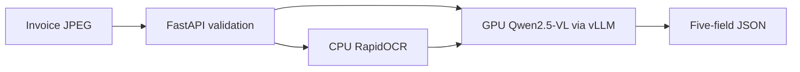
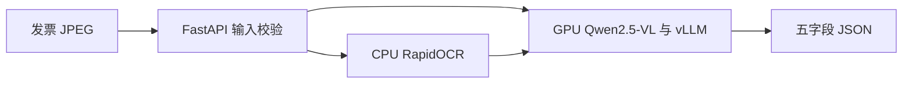

# Multimodal Tax Document Understanding with Qwen2.5-VL

[English](#english) · [中文](#中文)

<a name="english"></a>

## English

An image-to-JSON extraction service for Chinese VAT invoices, built with **Qwen2.5-VL-7B-Instruct, RapidOCR, vLLM, and FastAPI**.

### Engineering features

- Extracts invoice number, date, buyer name, buyer tax ID, and tax-inclusive total into a consistent JSON structure.
- Combines the original invoice image with OCR text for multimodal extraction.
- Provides LoRA training configuration and data preparation tools through LLaMA-Factory.
- Scores structured predictions with date and amount normalization, preserving leading zeros and JSON null for empty fields.
- Separates CPU OCR from GPU inference and returns explicit input-validation and upstream-service errors.

The serving configuration uses the base model with OCR. This source release includes code and configuration; invoice images, annotations, recorded cases, and evaluation outputs are not distributed.

### Architecture



### Core code map

| Capability | Implementation |
|---|---|
| JPEG validation, OCR, and API errors | [api.py](app/api.py) |
| Image + OCR prompt and vLLM request | [infer.py](app/infer.py) |
| Five-field extraction instructions | [invoice_prompt.txt](configs/invoice_prompt.txt) |
| Multimodal training data conversion | [prepare_training.py](scripts/prepare_training.py) |
| LoRA configuration and log retention | [lora.yaml](configs/lora.yaml), [training guide](docs/training.md) |
| Field and exact-document scoring | [score.py](scripts/score.py) |
| GPU serving configuration | [serve_model.sh](scripts/serve_model.sh) |

### Start the service

Use a CUDA-enabled Linux GPU environment with compatible PyTorch and vLLM dependencies.

```bash
python -m venv .venv
source .venv/bin/activate
pip install -r requirements.txt
pip install vllm
bash scripts/serve_model.sh
```

Set MODEL_PATH to a local model directory if needed. The model server listens on 127.0.0.1:18641. Start the gateway in a second terminal using the same environment:

```bash
uvicorn app.api:app --host 127.0.0.1 --port 18642
```

Open http://127.0.0.1:18642/docs to call POST /extract/tax with an image_b64 string and optional use_ocr boolean. OCR is enabled by default. Inputs must be JPEG images of no more than 20 million pixels. Invalid inputs return 422, invalid upstream output returns 502, OCR failures return 503, and model timeouts return 504. See the [API contract and tests](docs/api.md). Use SSH forwarding for remote access to the loopback service.

### Offline tests

```bash
python -m unittest discover -s tests -v
```

No GPU or model weights are needed. See [test coverage](docs/api.md).

### Training and evaluation tools

Install LLaMA-Factory separately. Prepare data/manifest.json with a train list; each entry contains id and a five-field target object. Put matching images in images/id.jpg. Review configs/lora.yaml before training.

```bash
python scripts/prepare_training.py
llamafactory-cli train configs/lora.yaml
```

For scoring, prepare a gold JSON with a docs list of id/target entries. Each id.json in the predictions directory must contain a fields object.

```bash
python scripts/score.py data/gold.json outputs/predictions
```

Use authorized data and fix the split before evaluation. See [data notes](docs/data.md) for provenance. Dependencies: [Qwen2.5-VL](https://github.com/QwenLM/Qwen2.5-VL), [LLaMA-Factory](https://github.com/hiyouga/LLaMA-Factory), [RapidOCR](https://github.com/RapidAI/RapidOCR), and [vLLM](https://github.com/vllm-project/vllm).

---

<a name="中文"></a>

## 中文

基于 **Qwen2.5-VL-7B-Instruct、RapidOCR、vLLM 和 FastAPI** 的中文增值税发票图片转 JSON 服务。

### 工程能力

- 统一抽取票号、日期、购买方名称、购买方税号和价税合计。
- 将原始票面与 OCR 文字联合输入模型，完成多模态结构化抽取。
- 提供 LLaMA-Factory LoRA 训练配置与数据准备工具。
- 对结构化预测进行日期和金额归一化评分，保留前导零，空栏要求 JSON null。
- 分离 CPU OCR 与 GPU 推理，提供明确的输入校验和上游错误响应。

服务配置使用基座模型加 OCR。当前源码目录公开代码与配置，不分发发票原图、标注、历史案例或评测输出。

### 系统架构



### 核心代码导航

| 能力 | 实现入口 |
|---|---|
| JPEG 校验、OCR 与 API 错误响应 | [api.py](app/api.py) |
| 图像与 OCR 提示词、vLLM 请求 | [infer.py](app/infer.py) |
| 五字段抽取指令 | [invoice_prompt.txt](configs/invoice_prompt.txt) |
| 多模态训练数据转换 | [prepare_training.py](scripts/prepare_training.py) |
| LoRA 配置与日志留存 | [lora.yaml](configs/lora.yaml)、[训练说明](docs/training.md) |
| 字段及整票评分 | [score.py](scripts/score.py) |
| GPU 服务配置 | [serve_model.sh](scripts/serve_model.sh) |

### 启动服务

使用支持 CUDA 的 Linux GPU 环境，匹配 PyTorch 与 vLLM 依赖。

```bash
python -m venv .venv
source .venv/bin/activate
pip install -r requirements.txt
pip install vllm
bash scripts/serve_model.sh
```

可设置 MODEL_PATH 指向本地模型目录。模型服务监听 127.0.0.1:18641。在使用同一环境的另一个终端启动网关：

```bash
uvicorn app.api:app --host 127.0.0.1 --port 18642
```

访问 http://127.0.0.1:18642/docs，通过 POST /extract/tax 提交 image_b64 字符串和可选的 use_ocr 布尔值。OCR 默认开启。输入须为 JPEG，且不超过两千万像素。无效输入返回 422，上游输出异常返回 502，OCR 故障返回 503，模型超时返回 504。详见[接口契约与测试](docs/api.md)。远程使用时可通过 SSH 转发访问回环服务。

### 离线测试

```bash
python -m unittest discover -s tests -v
```

无需 GPU 或模型权重，覆盖范围见[测试说明](docs/api.md)。

### 训练与评测工具

单独安装 LLaMA-Factory。准备 data/manifest.json，其中 train 列表的每项包含 id 与五字段 target 对象；对应图片存放在 images/id.jpg。训练前检查 configs/lora.yaml。

```bash
python scripts/prepare_training.py
llamafactory-cli train configs/lora.yaml
```

评分参考 JSON 包含 docs 列表，每项包含 id 和 target。预测目录内的每个 id.json 包含 fields 对象。

```bash
python scripts/score.py data/gold.json outputs/predictions
```

使用有权使用的数据，评测前固定划分。来源见[数据说明](docs/data.md)。技术依赖：[Qwen2.5-VL](https://github.com/QwenLM/Qwen2.5-VL)、[LLaMA-Factory](https://github.com/hiyouga/LLaMA-Factory)、[RapidOCR](https://github.com/RapidAI/RapidOCR) 和 [vLLM](https://github.com/vllm-project/vllm)。
